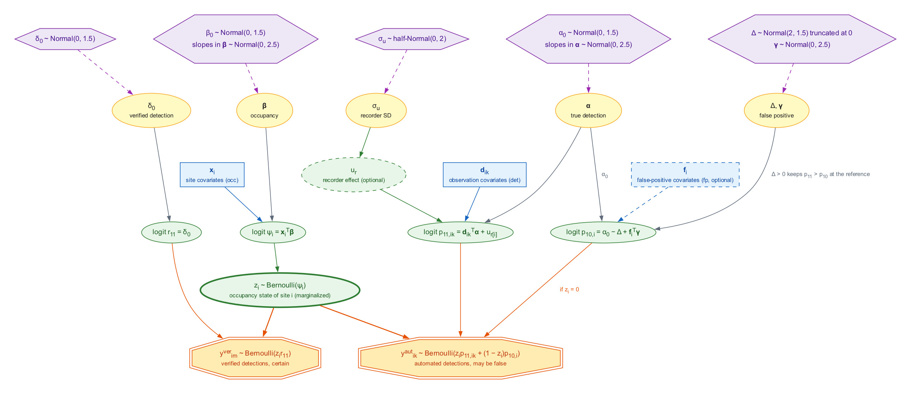

```{r setup, include = FALSE}
has_stan <- crywolf:::.has_cmdstan()
knitr::opts_chunk$set(
  collapse = TRUE, comment = "#>",
  fig.width = 6.5, fig.height = 4, out.width = "100%", fig.align = "center",
  eval = has_stan   # chunks that fit models run only when CmdStan is available
)
# drop the sampler's progress messages from the printed output
progress <- "^(#> )?(Running MCMC|Chain [0-9]+ finished|All [0-9]+ chains|Both chains|Mean chain|Total execution)"
output_hook <- knitr::knit_hooks$get("output")
knitr::knit_hooks$set(output = function(x, options) {
  lines <- strsplit(x, "\n")[[1]]
  lines <- lines[!grepl(progress, lines)]
  while (length(lines) && grepl("^(#> )?\\s*$", lines[1])) lines <- lines[-1]
  if (!length(lines)) return("")
  output_hook(paste0(paste(lines, collapse = "\n"), "\n"), options)
})
# format a number for the text; the argument is evaluated only with CmdStan
num <- function(x, digits = 2) {
  if (has_stan) formatC(x, digits = digits, format = "f") else "NA"
}
```

## Introduction

Automated detectors, such as the acoustic classifiers that scan thousands of
hours of recordings (e.g. BirdNET; Kahl et al., 2021), make two kinds of
mistakes. They miss calls of the target species (false negatives), and they
label other sounds as the target species (false positives). Occupancy models
deal with the first kind by repeating surveys at each site (MacKenzie et al.,
2002), but they assume that every detection is real. Ignoring false positives
inflates occupancy and, as we show below, can also distort the effect of
environmental covariates on occupancy (Royle & Link, 2006).

**crywolf** fits the multiple-methods false-positive occupancy model of Miller
et al. (2011) in a Bayesian framework, using Stan through the 'cmdstanr'
interface. In this design, the automated method runs at every site, and a
subset of its output, or a separate survey, is verified by an expert, so that
some detections are known to be correct. The verified data tell the model
how often the automated method is wrong. Chambert et al. (2015) and Clare et
al. (2021) review this and other designs for false-positive error.

The package also simulates data under different false-positive regimes and
checks, by simulation, whether the credible intervals of a model are
calibrated for a given design. The simulation study behind the package
(Provete et al., in preparation) showed that a constant false-positive rate
gives well-calibrated intervals for the occupancy slope when false positives
are homogeneous across sites. Random variation of the rate among sites made
the estimate of the rate itself unreliable, but largely spared the occupancy
slope (coverage of 0.81, against the nominal 0.95). When the rate tracked an
environmental gradient correlated with the occupancy covariate, and the
confusion was strong, the occupancy slope was biased towards zero and its
intervals rarely contained the true value, and verifying up to 90% of the
sites did not fix it. Letting the false-positive rate depend on covariates
did. Weak confusion left the constant-rate model calibrated.

This vignette walks through a complete analysis with simulated data:

- assembling data with `fp_data()` and
  `simulate_fp()`;
- the model, its priors, and how to change them with
  `fp_priors()`;
- fitting models with `fp_occu()`, with a constant
  false-positive rate and with a rate that depends on site covariates;
- convergence diagnostics and posterior predictive checks with
  `fp_ppc()`;
- model comparison with leave-one-site-out cross-validation, and prediction
  (see `?fp_occu-methods`);
- detection covariates and recorder random effects;
- the observation-confirmation design of Chambert et al. (2015), in which
  an expert checks the observations of some automated occasions.

`fp_calibrate()`, which checks the
calibration of a model for your own design, has its own vignette,
`vignette("calibration", package = "crywolf")`.

### Installation

crywolf fits its models with [CmdStan](https://mc-stan.org/cmdstanr/)
through 'cmdstanr', which is not on CRAN. Install both once, then the package
from GitHub:

```{r install, eval = FALSE}
install.packages("cmdstanr", repos = c("https://stan-dev.r-universe.dev",
                                       getOption("repos")))
cmdstanr::install_cmdstan()
remotes::install_github("diogoprov/crywolf")
```

We load the package, together with 'ggplot2' and 'bayesplot' for the
figures, and set a seed so that the results can be reproduced.

```{r load, eval = TRUE}
library(crywolf)
library(ggplot2)
library(bayesplot)
set.seed(2026)
```

## Example data

### The multiple-methods design

Each site $i$ is surveyed $K_i$ times by the automated method, for example $K_i$
recordings scanned by a classifier. These are the *automated* occasions; each
gives a detection ($y_{ik} = 1$) or not ($y_{ik} = 0$), and a detection may be a
false positive. At a subset of sites, an expert also checks $M_i$ occasions,
for example by listening to clips. These are the *verified* occasions
($v_{im}$). A verified detection is certain: the species was there.

### Simulated data

We simulate 300 sites with 20 automated occasions each, of which about 30%
are verified on three occasions. Occupancy declines along a standardized
covariate `x` (true slope $-0.8$). False positives are rare on average
(baseline rate 0.05), but they increase along a second gradient, `w`, whose
correlation with `x` is 0.7. This is what happens, for instance, when a
soundalike species becomes more common where the target is rare. In real
data, `w` is usually not measured; `simulate_fp()`
returns it so that we can fit the true model as a positive control.

```{r simulate, eval = TRUE}
sim <- simulate_fp(nsite = 300, nocc = 20, psi = 0.5, b1 = -0.8,
                   p11 = 0.6, p10 = 0.05,
                   conf_effect = 1.5, conf_cor = 0.7,
                   frac_verified = 0.3, seed = 2026)
sim$data
```

The data object holds three tables in long format, one row per occasion: the
automated detections (`auto`, with two observation covariates and a recorder
identifier), the verified detections (`verified`), and the sites with their
covariates (`sites`).

```{r data-tables, eval = TRUE}
head(sim$data$auto)
head(sim$data$verified)
head(sim$data$sites)
```

The element `truth` holds the generating values. Because the false-positive
rate depends on `w`, it varies among sites: its mean over sites is
`r round(sim$truth$p10_marginal, 3)`, about twice the baseline, and it is
highest where the target is least likely to occur.

```{r fig-p10, eval = TRUE, fig.cap = "True false-positive rate at each site against the occupancy covariate x, coloured by the confusing gradient w."}
p10_sites <- sim$data$sites
p10_sites$p10 <- sim$truth$p10_site
ggplot(p10_sites, aes(x, p10, colour = w)) +
  geom_point(alpha = 0.8) +
  scale_colour_viridis_c() +
  labs(x = "Occupancy covariate (x)",
       y = "False-positive rate (p10)", colour = "w") +
  theme_minimal()
```

### Your own data

`fp_data()` builds the same object from your own
tables. Each needs a site column and a 0/1 detection column; covariates are
taken from `sites` (for occupancy and false positives) and from `auto` (for
true detection). Sites may differ in the number of occasions.

```{r own-data, eval = TRUE}
auto <- data.frame(
  site = rep(c("A", "B", "C"), times = c(3, 2, 3)),
  y    = c(1, 0, 1,  0, 0,  1, 1, 0),
  wind = c(0.2, -0.5, 1.1, 0.3, -1.4, 0.8, 0.0, -0.6)
)
verified <- data.frame(site = c("A", "A", "C"), y = c(1, 0, 0))
sites <- data.frame(site = c("A", "B", "C"), forest = c(0.4, -1.2, 0.8))
fp_data(auto, sites, verified)
```

Site A has a verified detection, so it is known to be occupied. If your
detections are stored as site-by-occasion matrices, as in 'unmarked', use
`fp_data_wide()` instead.

## The multiple-methods false-positive occupancy model

### Basic model description

Let $z_i$ be the true occupancy state of site $i$ ($z_i = 1$ if the species
is present). We model it as

$$
z_i \sim \text{Bernoulli}(\psi_i), \qquad
\text{logit}(\psi_i) = \mathbf{x}_i^\top \boldsymbol{\beta},
$$

where $\psi_i$ is the occupancy probability, $\mathbf{x}_i$ is the vector of
site covariates (with a leading 1 for the intercept), and
$\boldsymbol{\beta}$ the vector of occupancy coefficients.

A detection by the automated method on occasion $k$ can come from an occupied
site (a true detection, with probability $p_{11,ik}$) or from an unoccupied
site (a false positive, with probability $p_{10,i}$):

$$
y_{ik} \mid z_i \sim \text{Bernoulli}\left(z_i\, p_{11,ik} + (1 - z_i)\, p_{10,i}\right).
$$

The true-detection probability depends on observation covariates
$\mathbf{d}_{ik}$ (e.g. background noise on that recording) and, optionally,
on a random intercept $u_{r}$ for the recorder $r$ used at the site:

$$
\text{logit}(p_{11,ik}) = \mathbf{d}_{ik}^\top \boldsymbol{\alpha} + u_{r[i]},
\qquad u_r \sim \text{Normal}(0, \sigma_u^2),
$$

where the first element of $\boldsymbol{\alpha}$, $\alpha_0$, is the
intercept. The false-positive rate depends on site covariates
$\mathbf{f}_i$:

$$
\text{logit}(p_{10,i}) = \gamma_0 + \mathbf{f}_i^\top \boldsymbol{\gamma},
\qquad \gamma_0 = \alpha_0 - \Delta, \quad \Delta > 0.
$$

With no covariates in $\mathbf{f}_i$, the rate is constant across sites.

The verified method cannot produce false positives. Its detection probability
is $r_{11}$:

$$
v_{im} \mid z_i \sim \text{Bernoulli}(z_i\, r_{11}),
\qquad \text{logit}(r_{11}) = \delta_0.
$$

**The gap $\Delta$.** Without further constraints, the model has two
equivalent solutions: one in which occupied sites are those with many
detections, and one in which the labels of the two states are swapped. We
write the false-positive intercept as the true-detection intercept minus a
positive gap, $\Delta$, so that at the reference values of the covariates
(all zero) a true detection is always more likely than a false positive. This
removes the label switching. Because the reference is the point where all
covariates are zero, centre or standardize them, so that the constraint
applies at an average site.

**The role of the verified data.** A site with at least one verified detection
is known to be occupied. Verified data at occupied and unoccupied sites
separate the two sources of automated detections and anchor $p_{10}$. Without
any verified data the false-positive rate is informed only by the priors and
the gap, and `fp_occu()` warns about it.

**Likelihood.** The latent state $z_i$ is summed out, so the likelihood of
site $i$ is

$$
\begin{aligned}
L_i ={}& \psi_i \prod_{k} p_{11,ik}^{y_{ik}} (1 - p_{11,ik})^{1 - y_{ik}}
\prod_{m} r_{11}^{v_{im}} (1 - r_{11})^{1 - v_{im}} \\
&+ (1 - \psi_i) \prod_{k} p_{10,i}^{y_{ik}} (1 - p_{10,i})^{1 - y_{ik}}
\prod_{m} (1 - v_{im}),
\end{aligned}
$$

where the last product is zero at sites with a verified detection and one
elsewhere. Summing out $z_i$ makes sampling efficient in Stan and gives one
log-likelihood value per site, which we use for cross-validation below.
The Stan program itself is in the file returned by `fp_stan_file()`.

**The model as a graph.** The directed acyclic graph below shows how the
pieces fit together, from the priors (top) to the data (bottom). The
automated detections $y_{ik}$ appear as $y^{aut}_{ik}$ and the verified
detections $v_{im}$ as $y^{ver}_{im}$. Both depend on the latent state
$z_i$, which is why the verified data, through $z_i$, inform the
false-positive rate.

```{r dag, echo = FALSE, out.width = "100%", fig.cap = "Directed acyclic graph of the multiple-methods false-positive occupancy model fitted by `fp_occu()`. Hexagons are priors (defaults of `fp_priors()`), yellow ellipses are parameters, blue boxes are covariates, green ellipses are latent quantities and linear predictors, and octagons are the observed data. Dashed outlines mark optional components: false-positive covariates (`fp = ~ ...`) and the recorder random intercept (`random_recorder = TRUE`). Adapted from the fpcalib research compendium."}

```

### Priors

All parameters have explicit priors on the logit scale, which are weakly
informative when covariates are standardized:

| Parameter | Prior (default) | Argument of `fp_priors()` |
|---|---|---|
| Intercepts $\beta_0$, $\alpha_0$, $\delta_0$ | $\text{Normal}(0, 1.5)$ | `intercept_sd` |
| Slopes in $\boldsymbol{\beta}$, $\boldsymbol{\alpha}$, $\boldsymbol{\gamma}$ | $\text{Normal}(0, 2.5)$ | `slope_sd` |
| Gap $\Delta$ | $\text{Normal}(2, 1.5)$, truncated at 0 | `gap_mean`, `gap_sd` |
| Recorder SD $\sigma_u$ | $\text{half-Normal}(0, 2)$ | `recorder_sd` |

A Normal(0, 1.5) prior on an intercept is roughly flat on the probability
scale between 0.05 and 0.95. The prior on $\Delta$ places the false-positive
rate at the reference about an order of magnitude below true detection, while
leaving room for the data to move it. `fp_priors()`
prints the settings and lets you change them:

```{r priors, eval = TRUE}
fp_priors()
fp_priors(slope_sd = 1, gap_sd = 1)
```

### Parameter names

The output labels each coefficient by its process and by the column of the
design matrix it multiplies:

| Symbol | Output name |
|---|---|
| $\boldsymbol{\beta}$ | `occ_(Intercept)`, `occ_x`, ... |
| $\boldsymbol{\alpha}$ | `det_(Intercept)`, `det_bio`, ... |
| $\gamma_0$, $\boldsymbol{\gamma}$ | `fp_(Intercept)`, `fp_w`, ... |
| $\Delta$ | `fp_gap` |
| $\delta_0$, $r_{11}$ | `verified_(Intercept)`, `p_verified` |
| $\sigma_u$ | `sd_recorder` |
| $p_{11}$, $p_{10}$ at the reference | `p11_ref`, `p10_ref` |
| mean of $p_{10,i}$ over the sites | `p10_bar` |

## Fitting the constant-rate model with fp_occu()

`fp_occu()` takes one formula for each process:
`occ` for occupancy, `det` for true detection, and `fp` for the
false-positive rate. With `fp = ~ 1` the rate is constant across sites, which
is what most applications assume. `random_recorder` adds the recorder random
intercept; the simulated data include a recorder column, but recorders have
no effect in this simulation, so we turn it off. The sampler runs four chains
of 1000 warm-up and 1000 sampling iterations by default (`chains`,
`iter_warmup`, `iter_sampling`), with a target acceptance rate
`adapt_delta = 0.95`; other arguments are passed to the `$sample()` method of
'cmdstanr'. With many sites or occasions, `threads_per_chain` lets each chain
use several cores (see `vignette("stan_model", package = "crywolf")`). The
model is compiled the first time it is used and cached for later sessions.

```{r fit-constant}
m_const <- fp_occu(sim$data, occ = ~ x, det = ~ 1, fp = ~ 1,
                   random_recorder = FALSE, seed = 1)
m_const
```

The printed table gives, for each parameter, the posterior mean, standard
deviation, the limits of the 95% equal-tailed credible interval, and the
convergence diagnostics discussed in the next section. The true-detection
probability at the reference, `p11_ref`, and the probability of detection by
the verified method, `p_verified`, are on the probability scale; the other
coefficients are on the logit scale.

## Convergence and model adequacy

Before interpreting any estimate, we check that the chains converged and that
the model reproduces the data. These steps, together with the model
comparison and the simulation-based checks of
`vignette("calibration", package = "crywolf")`, follow the Bayesian workflow
described by Gelman et al. (2026).

### Convergence

`fp_occu()` reports, for every parameter, the
rank-normalized $\hat{R}$ (`rhat`) and the bulk and tail effective sample sizes
(`ess_bulk`, `ess_tail`), and summarizes the sampler diagnostics in the last
line of the output: the number of divergent transitions, the largest
$\hat{R}$, and the smallest effective sample sizes. It warns when there are
divergent transitions, when $\hat{R} > 1.01$, or when the bulk ESS is below
400. In this fit there were `r num(m_const$diagnostics$divergences, 0)`
divergent transitions, the largest $\hat{R}$ was
`r num(m_const$diagnostics$max_rhat, 3)`, and the smallest bulk ESS was
`r num(m_const$diagnostics$min_ess_bulk, 0)`, so the chains mixed well.
`summary()` returns the same table, with an adjustable interval width:

```{r summary}
summary(m_const, prob = 0.9)
```

Trace plots show whether the chains explored the same region of the
posterior. `as_draws_df()` returns the draws
with readable names, which 'bayesplot' can plot directly:

```{r fig-trace, fig.height = 3.5, fig.cap = "Trace plots of the occupancy slope and of the gap between the true-detection and false-positive intercepts, for the four chains."}
draws_const <- as_draws_df(m_const)
color_scheme_set("purple")
mcmc_trace(draws_const, pars = c("occ_x", "fp_gap"))
```

### Posterior predictive check

A posterior predictive check compares the observed data with data replicated
from the fitted model (Gabry et al., 2019).
`fp_ppc()` does this for the number of detections
at each site. For each posterior draw, it draws the occupancy state of each
site from its conditional posterior, replicates the detections, and computes
a discrepancy statistic (by default, Freeman-Tukey) for the observed and the
replicated data. The Bayesian p-value is the proportion of draws in which the
replicated discrepancy exceeds the observed one; values near 0 or 1 indicate
lack of fit.

```{r ppc-const}
ppc_const <- fp_ppc(m_const, seed = 1)
ppc_const
```

The elements `y` and `yrep` follow the conventions of 'bayesplot', so its
`ppc_*()` functions work directly. Here we compare the distribution of the
number of detections per site in the observed and replicated data:

```{r fig-ppc-const, fig.cap = "Posterior predictive check of the constant-rate model: number of sites with each number of automated detections, observed (bars) and replicated (points and intervals)."}
ppc_bars(ppc_const$y, ppc_const$yrep) +
  labs(x = "Automated detections per site", y = "Number of sites")
```

The Bayesian p-value of the constant-rate model is
`r num(ppc_const$p_value)`. The check flags a lack of fit: the model does not
reproduce how detections are distributed among sites. In the figure, the
replicated data have too few sites with no detections and too many with one
or two, which is what we expect when the false-positive rate is in fact low
at some sites and high at others. The next section shows why this matters.

## Modelling the false-positive rate

### Why the occupancy slope is biased

The true occupancy slope is $-0.8$. The constant-rate model estimates it at
`r num(coef(m_const)["occ_x"])`:

```{r coef-const}
coef(m_const, "occ")
```

False positives in these data increase along `w`, which is correlated with
`x`. A model that assumes a constant false-positive rate cannot attribute the
extra detections at sites with high `w` to false positives, so it attributes
part of them to occupancy. Sites where the classifier is fooled most look like
sites where the species is present, and the occupancy slope is pulled towards
zero. In the simulation study behind this package, verifying more sites did
not remove this bias: verification anchors the mean false-positive rate, but
not its dependence on the covariate, so a constant-rate model passes that
dependence on to the occupancy slope however precisely the mean is estimated
(Provete et al., in preparation).

### A false-positive rate that tracks the occupancy covariate

The practical remedy is to let the false-positive rate depend on the
occupancy covariate, which is always available:

```{r fit-x}
m_x <- fp_occu(sim$data, occ = ~ x, det = ~ 1, fp = ~ x,
               random_recorder = FALSE, seed = 1)
coef(m_x, "fp")
```

The coefficient `fp_x` captures the part of the confusion that is correlated
with `x`. In the simulation study, this model reduced the bias of the
occupancy slope by 34 to 62% when the confusing gradient had a correlation of
0.7 with the occupancy covariate, and its intervals became better calibrated
as more sites were verified, although coverage remained below the nominal
level. When false positives depended on the occupancy covariate exactly, this
model was fully calibrated (Provete et al., in preparation).

### A false-positive rate that tracks the confusing gradient

If you have measured something that drives the confusion, such as the
abundance of a soundalike species or an index of background noise, put it in
the `fp` formula. In a simulation we know the confusing gradient `w`, so we
can fit the generating model as a positive control:

```{r fit-w}
m_w <- fp_occu(sim$data, occ = ~ x, det = ~ 1, fp = ~ w,
               random_recorder = FALSE, seed = 1)
summary(m_w)
```

The estimated effect of `w` on the false-positive rate is
`r num(coef(m_w)["fp_w"])` (true value 1.5). Measured covariates are rarely
the confusing gradient itself. In the simulation study, a proxy of the
gradient (correlation 0.7 with `w`, related to `x` only through `w`)
recovered less than the occupancy covariate did, reducing the bias of the
slope by 17 to 37%. Only the part of the gradient aligned with the occupancy
covariate distorts its slope, and the occupancy covariate captures that part
by construction. The recommendation is therefore to include the occupancy
covariates in `fp`, add any measured correlate of the confusion, and verify
enough sites to tell the effects apart (Provete et al., in preparation).

The figure compares the occupancy slope of the three models with its true
value.

```{r fig-slopes, fig.height = 3, fig.cap = "Posterior mean and 95% credible interval of the occupancy slope under three models of the false-positive rate. The dashed line marks the true value."}
slopes <- list(`fp = ~ 1` = m_const, `fp = ~ x` = m_x, `fp = ~ w` = m_w) |>
  purrr::imap(function(m, nm) {
    tab <- summary(m)$table
    data.frame(model = nm, tab[tab$variable == "occ_x", c("mean", "lower", "upper")])
  }) |>
  purrr::list_rbind()
slopes$model <- factor(slopes$model, levels = rev(slopes$model))
ggplot(slopes, aes(mean, model)) +
  geom_vline(xintercept = -0.8, linetype = "dashed") +
  geom_pointrange(aes(xmin = lower, xmax = upper), colour = "#5B2A86") +
  labs(x = "Occupancy slope on x", y = NULL) +
  theme_minimal()
```

The posterior predictive checks of the three models agree with this picture:

```{r ppc-all}
list(`fp = ~ 1` = ppc_const, `fp = ~ x` = fp_ppc(m_x, seed = 1),
     `fp = ~ w` = fp_ppc(m_w, seed = 1)) |>
  purrr::map_dbl("p_value")
```

Only the model with the confusing gradient has a p-value far from 0. A
posterior predictive check is a useful warning, but a p-value near 0.5 does
not show that the false-positive process is correctly specified: with fewer
occasions or weaker confusion, a misspecified model may pass the check and
still have a biased slope. To ask whether the intervals of a model are
calibrated for your design, use `fp_calibrate()`
(see `vignette("calibration", package = "crywolf")`).

### Sensitivity to the priors

To check that the conclusions do not depend on the priors, we refit the
model with `fp = ~ w` using narrower priors on the slopes and on the gap, and
compare the main parameters:

```{r sensitivity}
m_w_narrow <- fp_occu(sim$data, occ = ~ x, det = ~ 1, fp = ~ w,
                      random_recorder = FALSE, seed = 1,
                      priors = fp_priors(slope_sd = 1, gap_sd = 1))
pars <- c("occ_x", "fp_w", "fp_gap")
data.frame(parameter = pars,
           default = round(coef(m_w)[pars], 3),
           narrow  = round(coef(m_w_narrow)[pars], 3), row.names = NULL)
```

With 300 sites, the data dominate the priors and the estimates barely change.
With smaller data sets, the priors, particularly the one on $\Delta$, matter
more, and this comparison is worth reporting.

## Model comparison with LOO

Because the latent state is summed out, the pointwise log-likelihood is
computed per site, and `loo()` gives
approximate leave-one-site-out cross-validation by Pareto-smoothed
importance sampling (Vehtari et al., 2017). `loo_compare()` ranks the models
by their expected log predictive density (elpd):

```{r loo}
loo_const <- loo(m_const)
loo_x <- loo(m_x)
loo_w <- loo(m_w)
loo::loo_compare(list(`fp = ~ 1` = loo_const, `fp = ~ x` = loo_x,
                      `fp = ~ w` = loo_w))
```

The first row is the best model; `elpd_diff` is the difference in elpd from
it, with its standard error `se_diff`. Here the model with the confusing
gradient predicts best, followed by the model with `fp = ~ x`, and the
constant-rate model predicts worst; the differences are several times their
standard errors. Check the Pareto $k$ diagnostics printed by `loo()`: values
above 0.7 mean that the approximation is unreliable for those sites.

```{r loo-print}
loo_w
```

LOO measures predictive performance, not the bias of a particular
coefficient. It can tell which model of the false-positive rate fits better,
but not whether the occupancy slope of the best model is unbiased.

## Prediction

`predict()` returns the posterior mean and
credible interval of the occupancy probability (`process = "occ"`) or of the
false-positive rate (`process = "fp"`) for new values of the covariates.
With `summary = FALSE` it returns the matrix of posterior draws instead,
with one row per draw.

```{r predict}
nd <- data.frame(x = seq(-2, 2, by = 1))
predict(m_x, newdata = nd, process = "occ")
predict(m_x, newdata = nd, process = "fp")
```

Predicting over a grid of the occupancy covariate shows how the bias of the
slope translates into the occupancy probability:

```{r fig-predict, fig.cap = "Predicted occupancy probability (posterior mean and 95% credible interval) along the occupancy covariate under three models of the false-positive rate. The dashed line is the true relationship."}
grid <- data.frame(x = seq(-2.5, 2.5, length.out = 50))
pred <- list(`fp = ~ 1` = m_const, `fp = ~ x` = m_x, `fp = ~ w` = m_w) |>
  purrr::imap(function(m, nm) {
    data.frame(model = nm, predict(m, newdata = grid, process = "occ"))
  }) |>
  purrr::list_rbind()
truth <- data.frame(x = grid$x, psi = plogis(sim$truth$b0 + sim$truth$b1 * grid$x))
ggplot(pred, aes(x, estimate)) +
  geom_ribbon(aes(ymin = lower, ymax = upper, fill = model), alpha = 0.2) +
  geom_line(aes(colour = model)) +
  geom_line(aes(x, psi), data = truth, linetype = "dashed") +
  scale_colour_manual(values = c("#FF3EA5", "#2DE2E6", "#5B2A86")) +
  scale_fill_manual(values = c("#FF3EA5", "#2DE2E6", "#5B2A86")) +
  labs(x = "Occupancy covariate (x)", y = "Occupancy probability",
       colour = NULL, fill = NULL) +
  theme_minimal()
```

## Detection covariates and recorder effects

The true-detection formula accepts observation covariates (columns of
`auto`, which may change from occasion to occasion) and site covariates.
With `random_recorder = TRUE`, the model adds a random intercept for each
recorder, which absorbs differences in sensitivity among devices or
observers. Name the recorder column with the `recorder` argument of
`fp_data()`.

We simulate a second data set in which two acoustic indices, `bio` and
`aci`, affect true detection (effects 0.5 and $-0.3$), and ten recorders
differ in sensitivity (standard deviation 0.6 on the logit scale):

```{r fit-recorder, eval = FALSE}
sim_rec <- simulate_fp(nsite = 300, nocc = 20, a_bio = 0.5, a_aci = -0.3,
                       sd_recorder = 0.6, nrec = 10,
                       conf_effect = 1.5, conf_cor = 0.7, seed = 2027)
m_rec <- fp_occu(sim_rec$data, occ = ~ x, det = ~ bio + aci, fp = ~ w,
                 random_recorder = TRUE, seed = 1)
m_rec
```

When detection covariates change among occasions, each occasion enters the
likelihood separately, instead of being grouped with the other occasions of
its site, so the model takes longer to fit (about a minute here). To keep
this vignette quick to build, we show the saved output of this fit:

```{r recorder-output, eval = TRUE, echo = FALSE}
rec_fit <- readRDS("crywolf-recorder-fit.rds")
cat(rec_fit$printed, sep = "\n")
```

The effects of the acoustic indices (`det_bio`, `det_aci`), the standard
deviation among recorders (`sd_recorder`), and the effect of the confusing
gradient (`fp_w`) are close to their true values. The true-detection intercept, the gap, and the recorder standard deviation
have lower effective sample sizes than the other parameters, as is common
with random intercepts, but all are above the threshold of 400.

## The observation-confirmation design

In the design used so far, the verified method is separate from the
automated one, and its detections identify occupied sites. In many acoustic
studies, an expert instead listens to the clips that the classifier flagged
and labels each one as the target species or not. Chambert et al. (2015)
called this the *observation-confirmation* design. Each checked occasion
ends in one of four states: nothing was assigned to the species (0), all
assigned observations were false (1), all were true (2), or both kinds were
found (3). Because false observations can now be seen directly, at occupied
sites as well as at unoccupied ones, the model describes each occasion by
two probabilities: $s_1$, of at least one true observation (at an occupied
site), and $s_0$, of at least one false observation. The four states have
probabilities

$$
\Pr(v = 0, 1, 2, 3 \mid z = 1) =
\left[(1 - s_1)(1 - s_0),\; (1 - s_1)\, s_0,\; s_1 (1 - s_0),\; s_1 s_0\right],
\qquad
\Pr(v = 0, 1, 2, 3 \mid z = 0) = \left[1 - s_0,\; s_0,\; 0,\; 0\right],
$$

and an occasion that was not checked is a detection with probability
$p_{11} = 1 - (1 - s_1)(1 - s_0)$ at an occupied site and $p_{10} = s_0$ at
an unoccupied one. The formulas `det` and `fp` of `fp_occu()` then model
$\text{logit}(s_1)$ and $\text{logit}(s_0)$.

To use this design, add two columns to `auto` with the number of
observations confirmed as the species and as something else, `NA` on the
occasions that were not checked, and name them in the `confirmed` argument
of `fp_data()`. All observations of a checked occasion must be checked.
`simulate_fp()` generates such data with `frac_confirmed`, the probability
that an occasion is checked:

```{r sim-confirm, eval = TRUE}
sim_conf <- simulate_fp(nsite = 200, nocc = 10, p10 = 0.1,
                        frac_confirmed = 0.3, frac_verified = 0, seed = 2028)
sim_conf$data
head(sim_conf$data$auto[!is.na(sim_conf$data$auto$n_true), ])
```

Here no site has a separately verified survey: the confirmed occasions alone
identify the false-positive rate, so `fp_occu()` does not warn about missing
verified data.

```{r fit-confirm}
m_conf <- fp_occu(sim_conf$data, occ = ~ x, det = ~ 1, fp = ~ 1,
                  random_recorder = FALSE, seed = 1)
m_conf
```

The occupancy slope (true value $-0.8$), the probability of a false
observation `p10_ref` (true value 0.1), and the detection intercept, now the
logit of $s_1$ (true value 0.6, so `r num(qlogis(0.6))` on the logit scale),
are all estimated without verified surveys. Both kinds of known truth can be
combined: keep a verified method in `verified` and add confirmed occasions to
`auto`.

## Next steps

- `vignette("simulation", package = "crywolf")`: the false-positive regimes
  and observation options of `simulate_fp()`.
- `vignette("calibration", package = "crywolf")`: check whether a model's
  credible intervals are calibrated for your design, and how much to verify.
- `vignette("curiango", package = "crywolf")`: a case study with acoustic
  monitoring of the Common Pauraque and two classifiers.
- `vignette("unmarked", package = "crywolf")`: translating data and
  formulas from `unmarked::occuFP()`.
- `vignette("stan_model", package = "crywolf")`: the Stan program, and how
  to fit a modified copy.

## References

Chambert, T., Miller, D. A. W., & Nichols, J. D. (2015). Modeling false
positive detections in species occurrence data under different study
designs. *Ecology*, 96, 332–339. https://doi.org/10.1890/14-1507.1

Clare, J. D. J., Townsend, P. A., & Zuckerberg, B. (2021). Generalized
model-based solutions to false-positive error in species detection/nondetection
data. *Ecology*, 102, e03241. https://doi.org/10.1002/ecy.3241

Gabry, J., Simpson, D., Vehtari, A., Betancourt, M., & Gelman, A. (2019).
Visualization in Bayesian workflow. *Journal of the Royal Statistical Society
Series A: Statistics in Society*, 182, 389–402.
https://doi.org/10.1111/rssa.12378

Gelman, A., Vehtari, A., McElreath, R., Simpson, D., Margossian, C. C.,
Yao, Y., Kennedy, L., Gabry, J., Bürkner, P.-C., Modrák, M., & Leos Barajas,
V. (2026). *Bayesian Workflow*. Chapman & Hall.
https://avehtari.github.io/Bayesian-Workflow/

Kahl, S., Wood, C. M., Eibl, M., & Klinck, H. (2021). BirdNET: A deep
learning solution for avian diversity monitoring. *Ecological Informatics*,
61, 101236. https://doi.org/10.1016/j.ecoinf.2021.101236

MacKenzie, D. I., Nichols, J. D., Lachman, G. B., Droege, S., Royle, J. A.,
& Langtimm, C. A. (2002). Estimating site occupancy rates when detection
probabilities are less than one. *Ecology*, 83, 2248–2255.
https://doi.org/10.1890/0012-9658(2002)083[2248:ESORWD]2.0.CO;2

Miller, D. A., Nichols, J. D., McClintock, B. T., Grant, E. H. C., Bailey,
L. L., & Weir, L. A. (2011). Improving occupancy estimation when two types of
observational error occur: non-detection and species misidentification.
*Ecology*, 92, 1422–1428. https://doi.org/10.1890/10-1396.1

Provete, D. B., et al. (in preparation).

Royle, J. A., & Link, W. A. (2006). Generalized site occupancy models
allowing for false positive and false negative errors. *Ecology*, 87,
835–841. https://doi.org/10.1890/0012-9658(2006)87[835:GSOMAF]2.0.CO;2

Vehtari, A., Gelman, A., & Gabry, J. (2017). Practical Bayesian model
evaluation using leave-one-out cross-validation and WAIC. *Statistics and
Computing*, 27, 1413–1432. https://doi.org/10.1007/s11222-016-9696-4
