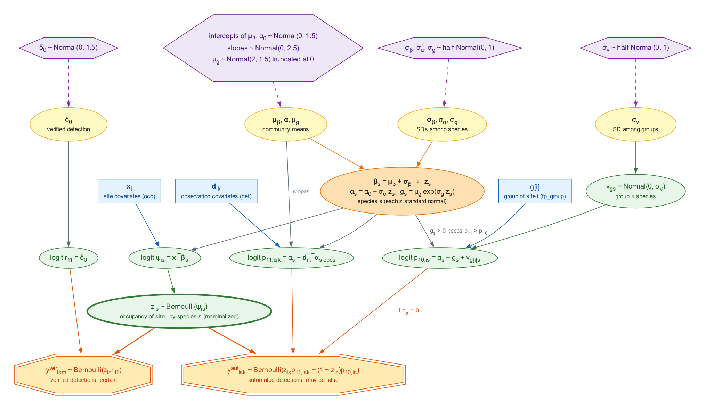
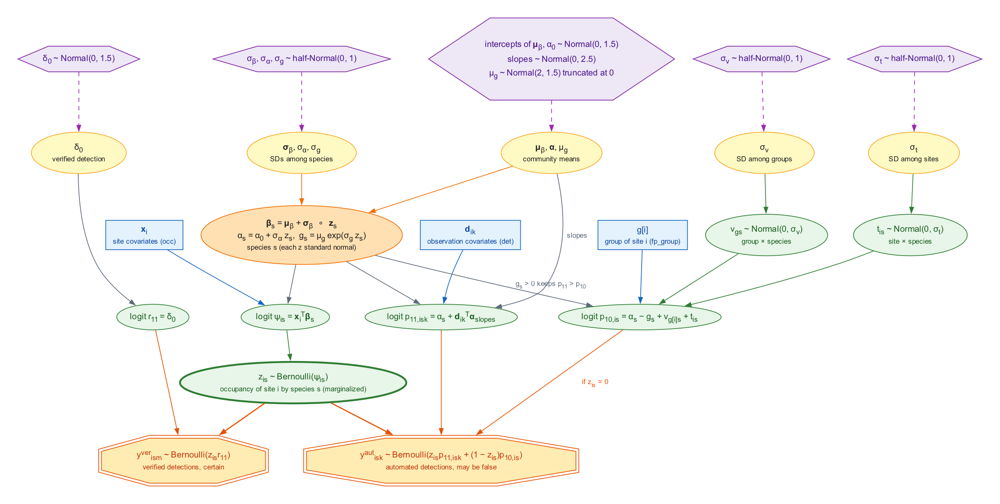

```{r setup, include = FALSE}
# The simulation results come from dev/ms-sim/run_sims.R (run on AWS) and
# dev/ms-sim/summarise.R, so that the article builds without Stan.
knitr::opts_chunk$set(collapse = TRUE, comment = "#>",
                      fig.width = 7, fig.height = 3.6, out.width = "100%")
library(crywolf)
res <- readRDS("multispecies-results.rds")
# a table of metrics() rows, rounded
mtab <- function(x, cols) {
  x <- x[cols]
  num <- vapply(x, is.numeric, logical(1))
  x[num] <- lapply(x[num], function(v) signif(v, 2))
  if ("max_rhat" %in% cols) x$max_rhat <- round(x$max_rhat, 3)
  knitr::kable(x, row.names = FALSE)
}
# one value of a metrics() table
val <- function(x, ..., what) {
  keys <- list(...)
  keep <- Reduce(`&`, Map(function(k, v) x[[k]] == v, names(keys), keys))
  x[[what]][keep]
}
pct <- function(x) paste0(round(100 * x), "%")
```

**`fp_occu_ms()` is in development** (see `?crywolf-api`): its arguments,
results and output names may change in a minor version.

A classifier run on passive acoustic recordings rarely targets one
species. The same recordings, the same recorders and often the same
reviewer serve the whole list of species that the classifier knows.
`fp_occu_ms()` fits the false-positive occupancy model of `fp_occu()` to all
of them at once. Each species keeps its own occupancy, true detection and
false-positive rate, but these are drawn from distributions of the
community, so that a species with few detections or few verified
occasions borrows strength from the others, as in the community occupancy
models of Dorazio and Royle (2005).

This article describes the model, and then a choice that the multispecies
setting makes pressing: how much the false-positive rate of a species may
vary among sites. The two forms compared here, called "fs" and "mixed",
differ in one random effect. The fitting code is shown but not run when the
article is built.

## The model

### Data

`fp_data(species = "species")` reads `auto` and `verified` tables with one
row per occasion and species. Every recorded occasion appears for every
species of the list, with `y = 0` where the species was not detected:
without these rows there are no non-detections. The species are those of
the list, and none is assumed to be absent from it, since the model has no
data augmentation for species never detected.

### Species and community

At site $i$, for species $s$ and automated occasion $k$, the model of
`vignette("crywolf")`, the multiple-methods design of Miller et al.
(2011), holds species by species:

$$
\mathrm{logit}(\psi_{is}) = \mathbf{x}_i^\top \boldsymbol{\beta}_s,
\qquad
\mathrm{logit}(p_{11,isk}) = \alpha_s + \mathbf{d}_{ik}^\top \boldsymbol{\alpha},
\qquad
\mathrm{logit}(p_{10,is}) = \alpha_s - g_s,
$$

where $\psi_{is}$ is the occupancy probability, $p_{11,isk}$ the probability
of an automated detection when the species is present, and $p_{10,is}$ the
probability of one when it is absent, a false positive. The gap $g_s > 0$
keeps the false-positive rate of each species below its true-detection rate
at the reference, as $\Delta$ does in `fp_occu()`. The species values are
drawn from the community, on the non-centred scale:

$$
\boldsymbol{\beta}_s = \boldsymbol{\mu}_\beta + \boldsymbol{\sigma}_\beta \circ \mathbf{z}_s,
\qquad
\alpha_s = \alpha_0 + \sigma_\alpha z_s,
\qquad
g_s = \mu_g \exp(\sigma_g z_s),
$$

with each $z$ standard normal and independent. The community means have the
priors of the intercepts, slopes and gap of `fp_priors()`, and the standard
deviations among species half-Normal priors with scale
`fp_priors()$species_sd` (1 by default). The slopes of `det`, the verified
detection probability $r_{11}$ and the recorder effect are shared by the
species unless `by_species` says otherwise. The false positives of a
species do not depend on the other species: the model describes a
classifier that labels a species where it is absent, not one that confuses
two species with each other.

## How much does the false-positive rate vary?

In the model above, the false-positive rate of a species is the same at
every site, up to the covariates of `fp`. In acoustic data this is rarely
true. The sounds that a classifier mistakes for a species (another frog
calling at the same pond, insects, rain, a road) belong to places, and
they change from month to month.

`fp_occu_ms()` offers two random effects on the logit of the false-positive
rate, both with half-Normal priors of scale `fp_priors()$fp_site_sd`. They
matter most when each "site" of the data is a site in one period, for
example a pond in one month, so that several sites of the data share one
physical site.

* `fp_group` names a column of the sites table that groups them, for
  example the physical site, and adds an effect $v_{gs}$ for each group
  $g$ and species $s$, reported through its standard deviation
  `sd_fp_group` ($\sigma_v$).
* `random_fp = TRUE` adds an effect $t_{is}$ for each site of the data
  and species, reported as `sd_fp_site` ($\sigma_t$).

The **fs** model uses the first one alone:

$$
\mathrm{logit}(p_{10,is}) = \alpha_s - g_s + v_{g[i]s},
\qquad v_{gs} \sim \mathrm{Normal}(0, \sigma_v).
$$

The **mixed** model adds the second one:

$$
\mathrm{logit}(p_{10,is}) = \alpha_s - g_s + v_{g[i]s} + t_{is},
\qquad t_{is} \sim \mathrm{Normal}(0, \sigma_t).
$$

```{r fit-code, eval = FALSE}
# sites are pond-months; the column "pond" names the physical site
m_fs    <- fp_occu_ms(d, occ = ~ x, det = ~ bio, fp = ~ 1, fp_group = "pond")
m_mixed <- fp_occu_ms(d, occ = ~ x, det = ~ bio, fp = ~ 1, fp_group = "pond",
                      random_fp = TRUE)
```

```{r dag-fs, echo = FALSE, out.width = "100%", fig.cap = "The fs model. Hexagons are priors, yellow ellipses community parameters, the orange ellipse the values of each species, blue rectangles data that enter as covariates, green ellipses random effects and linear predictors, and octagons the observed detections. The recorder effect and the slopes of fp and ver are left out."}

```

```{r dag-mixed, echo = FALSE, out.width = "100%", fig.cap = "The mixed model: the fs model with an effect of each site of the data and species, t, on the false-positive rate."}

```

### What tells the effects apart

The two random effects act only on the branch of the likelihood where the
species is absent. A site with automated detections of a species can be
explained in two ways: the species is present, or it is absent and the
false-positive rate there is high. The verified occasions, which contain no
false positives, are what separate the two explanations, and only at the
sites where they were made.

This has a consequence for each model, which follows from the likelihood
and which the simulations below measure. In the fs model, the effect
$v_{gs}$ is shared by all the sites of group $g$. A verified occasion at one
pond-month therefore informs the false-positive rate of the other months of
that pond. In the mixed model, $t_{is}$ belongs to one site of the data. At
a site with detections and no verified occasion, only $\sigma_t$ limits how
far $t_{is}$ can rise. When $\sigma_t$ is large, the posterior of such a
site can have two modes, one with the species present and $t_{is}$ near
zero and one with the species absent and $t_{is}$ high. Chains that settle
in different modes give large R-hat values for $\sigma_t$ and for those
sites.

A practical reading follows: fit the fs model first, and use the mixed
model as a check of how sensitive occupancy is to month-to-month variation
in false positives. The simulations below support this order for moderate
variation among sites, but they did not test large values of $\sigma_t$.
The convergence of the mixed model should be checked before its estimates
are compared with those of fs. Our interpretation, not tested, is that the
mixed model needs verified occasions spread over many sites of the data,
not only over many groups.

## Simulations

### Design

All datasets came from `simulate_fp_ms()`, with 100 sites, 10 automated
occasions per site and 30% of the sites verified on 3 occasions each.
Occupancy depended on a standardized covariate, with community mean
occupancy 0.4 at its mean (standard deviation among species 1 on the logit
scale) and community mean slope $-0.5$ (standard deviation 0.5). True
detection was 0.5 at the reference (standard deviation 0.5), with a shared
slope of 0.5 on an occasion covariate; the false-positive rate was 0.05 at
the median gap (standard deviation of the log gap 0.3); and verified
detection was 0.6. Every fit used the default priors of `fp_priors()`, 4
chains of 1000 warm-up and 1000 sampling iterations, and
`adapt_delta = 0.95`.

* **Recovery.** Communities of 5 and 20 species in three scenarios, with
  50 replicates each: all species as above ("base"); the first species
  rare, with occupancy 0.05 at the mean of the covariate ("rare"); and the
  first species without verified occasions ("unverified"). In the rare and
  unverified scenarios the first species was also fitted alone with
  `fp_occu()`, to measure what the community lends it. Communities of 50
  species, base scenario only, with 20 replicates, show how the model
  scales.
* **fs and mixed.** Communities of 10 species, the 100 sites in 25 groups
  of 4 (a physical site with four months), 50 replicates per scenario. In
  the "fs" scenario the false-positive rate varied among groups
  ($\sigma_v = 0.7$); in the "mixed" scenario it varied among groups and
  among sites ($\sigma_v = 0.7$, $\sigma_t = 0.5$). Both models were
  fitted to every dataset.
* **Simulation-based calibration.** Communities of 10 species at 80
  sites with 8 occasions, the community parameters drawn from the priors,
  200 replicates.

```{r sim-code, eval = FALSE}
s <- simulate_fp_ms(nspecies = 10, nsite = 100, nocc = 10, a_bio = 0.5,
                    ngroup = 25, sd_fp_group = 0.7, sd_fp_site = 0.5, seed = 1)
s$truth$pars[c("sd_fp_group", "sd_fp_site")]
m <- fp_occu_ms(s$data, occ = ~ x, det = ~ bio, fp = ~ 1, fp_group = "group",
                random_fp = TRUE)
```

### Results

```{r results-setup, include = FALSE}
fits <- res$fits
rec <- res$recovery
fm <- res$fs_mixed
conv <- function(...) pct(val(fits, ..., what = "converged"))
```

All the tables below come from `dev/ms-sim/summarise.R`. Coverage is the
share of 95% intervals that contained the true value, and width is the mean
width of these intervals. Values of each species are pooled over the
species of a community and marked `[sp]`.

#### Convergence and time

A fit counted as converged when every parameter with a true value had
R-hat below 1.01 and the sampler had no divergent transitions.

```{r fits-table, echo = FALSE}
mtab(fits, c("nspecies", "scenario", "model", "n", "converged",
             "with_divergences", "max_rhat", "min_ess", "median_hours"))
```

With 5 species, `r conv(nspecies = 5, scenario = "base", model = "ms")` of
the fits in the base scenario passed this criterion. With 20 species, only
`r conv(nspecies = 20, scenario = "base", model = "ms")` did. The fits that
failed had no divergences. Their largest R-hat was
`r round(max(val(fits, nspecies = 20, model = "ms", what = "max_rhat")), 3)`, and the
smallest bulk ESS was `r round(min(val(fits, nspecies = 20, model = "ms", what = "min_ess")))`
of 4000 draws. The parameters that crossed 1.01 most often were the
community intercepts of occupancy, detection and the false-positive rate.
Since these R-hat values stayed close to the threshold and the ESS was
large, longer chains seem a reasonable remedy for large communities; this
is our reading, not something the simulations tested. A fit of 20 species
took a median of `r round(val(fits, nspecies = 20, scenario = "base", model = "ms", what = "median_hours"), 1)`
hours, with the four chains in sequence on one core.

#### Recovery

```{r recovery-table, echo = FALSE}
r <- rec[rec$scenario == "base" & !grepl("\\[sp\\]$", rec$param), ]
mtab(r, c("nspecies", "param", "bias", "coverage", "width"))
```

The community means and the standard deviations among species were
recovered with small bias. Coverage ranged from
`r min(rec$coverage[rec$scenario == "base" & !grepl("\\[sp\\]$", rec$param)])` to
`r max(rec$coverage[rec$scenario == "base" & !grepl("\\[sp\\]$", rec$param)])`,
with 50 replicates per cell. The intervals were
narrower with more species. For the standard deviation of occupancy among
species, the mean width fell from
`r signif(val(rec, nspecies = 5, scenario = "base", param = "sd_occ_(Intercept)", what = "width"), 2)`
with 5 species to
`r signif(val(rec, nspecies = 20, scenario = "base", param = "sd_occ_(Intercept)", what = "width"), 2)`
with 20.

```{r recovery-species, echo = FALSE}
r <- rec[rec$scenario == "base" & grepl("\\[sp\\]$", rec$param), ]
mtab(r, c("nspecies", "param", "n", "bias", "coverage", "width"))
```

The values of each species, including the false-positive rate at the
reference, `p10_ref`, also had coverage close to 0.95.

#### A rare species and a species without verification

```{r sp1-table, echo = FALSE}
r <- res$sp1[res$sp1$param %in% c("occ_(Intercept)[sp1]", "p11_ref[sp1]",
                                  "p10_ref[sp1]"), ]
mtab(r, c("nspecies", "scenario", "model", "param", "rmse", "coverage", "width"))
```

For a rare species, the community helped most with detection. With 20
species, the root mean squared error of its true-detection probability
`p11_ref` was
`r signif(val(res$sp1, nspecies = 20, scenario = "rare", model = "ms", param = "p11_ref[sp1]", what = "rmse"), 2)`
in the multispecies fit and
`r signif(val(res$sp1, nspecies = 20, scenario = "rare", model = "single", param = "p11_ref[sp1]", what = "rmse"), 2)`
when the species was fitted alone. Its occupancy intercept gained less,
with a root mean squared error of
`r signif(val(res$sp1, nspecies = 20, scenario = "rare", model = "ms", param = "occ_(Intercept)[sp1]", what = "rmse"), 2)`
against
`r signif(val(res$sp1, nspecies = 20, scenario = "rare", model = "single", param = "occ_(Intercept)[sp1]", what = "rmse"), 2)`. Our reading, not tested here, is that the
detections of a rare species come from few sites, so the community
distribution of detection adds much to them, while its occupancy still
rests on which sites it was found at.

A species without verified occasions was recovered by both fits. In these
simulations the multispecies fit did not reduce the error of its
false-positive rate: the root mean squared error of `p10_ref` was
`r signif(val(res$sp1, nspecies = 20, scenario = "unverified", model = "ms", param = "p10_ref[sp1]", what = "rmse"), 2)`
in the multispecies fit and
`r signif(val(res$sp1, nspecies = 20, scenario = "unverified", model = "single", param = "p10_ref[sp1]", what = "rmse"), 2)`
alone, with 20 species.

#### fs and mixed

```{r fs-mixed-table, echo = FALSE}
r <- fm[fm$param %in% c("occ_(Intercept)[sp]", "p10_ref[sp]", "sd_fp_group",
                        "sd_fp_site"), ]
mtab(r, c("scenario", "model", "param", "bias", "coverage", "width"))
```

Both models recovered the occupancy and the false-positive rate of each
species in both scenarios. The fs model kept coverage close to 0.95 when
the false-positive rate also varied among sites, with $\sigma_t = 0.5$.
Larger values of $\sigma_t$ were not simulated. The mixed model recovered
both standard deviations, `sd_fp_group` and `sd_fp_site`.

The mixed model converged less often on the data that it describes:
`r conv(scenario = "mixed", model = "mixed")` of the fits passed the
criterion, against `r conv(scenario = "mixed", model = "fs")` for fs on the
same data. The parameter that failed most often was `sd_fp_site`, with
R-hat up to
`r round(val(fits, scenario = "mixed", model = "mixed", what = "max_rhat"), 3)` and a
bulk ESS as low as
`r round(val(fits, scenario = "mixed", model = "mixed", what = "min_ess"))`. This
is the mechanism described above, in a mild form.

#### Simulation-based calibration

```{r sbc, echo = FALSE}
s <- res$sbc
s$chisq_p <- signif(s$chisq_p, 2)
s$mean_rank <- round(s$mean_rank, 1)
knitr::kable(s, row.names = FALSE)
```

Of the `r res$sbc_fits[["n"]]` fits, `r res$sbc_fits[["failed"]]` failed
and `r res$sbc_fits[["with_divergences"]]` had divergent transitions. The
ranks of the true values among 99 posterior draws were tested for
uniformity in 10 bins, one chi-squared test per parameter. The smallest
p-value was `r signif(min(res$sbc$chisq_p), 2)`, which is not small after
`r nrow(res$sbc)` tests. The prior on the standard deviations among
species, half-Normal with scale `species_sd = 1`, therefore showed no sign
of miscalibration.

## References

Dorazio, R. M., & Royle, J. A. (2005). Estimating size and composition of
biological communities by modeling the occurrence of species. *Journal of
the American Statistical Association*, 100, 389–398.
https://doi.org/10.1198/016214505000000015

Miller, D. A., Nichols, J. D., McClintock, B. T., Grant, E. H. C.,
Bailey, L. L., & Weir, L. A. (2011). Improving occupancy estimation when
two types of observational error occur: non-detection and species
misidentification. *Ecology*, 92, 1422–1428.
https://doi.org/10.1890/10-1396.1
